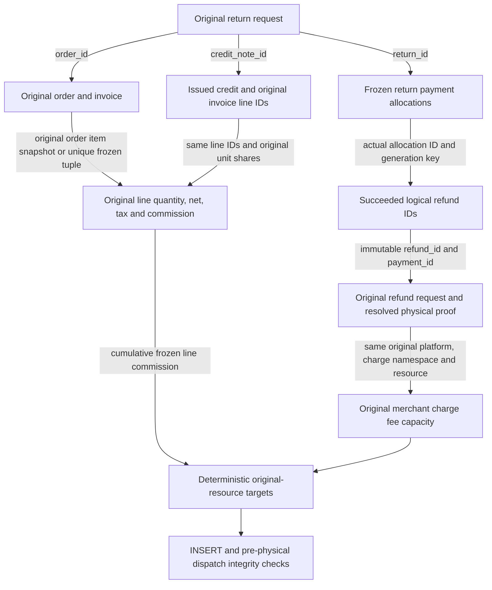

<!-- Copyright (C) 2026 Tony Aly; SPDX-License-Identifier: Apache-2.0 -->
# Original returned-line commission (C5.19/C12.38)

The actual isolated80 BEFORE a652ce7d reproduced a wrong commission refund in
5.354s on normal-v8 SQL1ac4652c. One original seller's invoice was5400CAD cents:
line4000net+200tax/400fee and returned line1000net+200tax/100fee. Actual shared
checkout, capture and RMA services issued the1200credit and completed the1200
customer refund. One synthetic fee-resource edge accepted112 instead of the
returned line's frozen100, because reconciliation used the gross invoice ratio.
The first attempt618 stopped at a fixture-only category-code validation before
any money; the exact underscore-literal correction is preserved separately.

The BEFORE fixture uses real business services with synthetic payment edges;
it does not establish an actual provider-account or protected-main defect.
Its source starts at the earlier isolateda67 composition. Latest protected
imports/media source must still compose and regress before final qualification.

The actual populated wrong-fee database is preserved unchanged as
`freeholder_rma_fee_budget80_populated_before_v8_test_20261112`. A real template
clone checked source had no backends, retained81 normal journal entries/SQL1ac,
and matched counts and canonical SHA256 across all eight original money/credit/
allocation tables. The accepted112 resource is never rewritten to100.
Logs: `/tmp/freeholder-rma-fee-budget80-before-native-v2-v8.{json,log}` with
`-ledger.json`/`-drain.json`, and
`/tmp/freeholder-rma-fee-budget80-populated-clone-v8.{json,log}`.

The source repair remains unqualified. A private catalog source proves the
actual return→credit→frozen payment allocation→refund IDs/generations. Invoicing
independently checks the immutable original line quantities, issued credit
lines, exact refund requests and resolved original physical money. Equal totals
are only conservation checks after those references are proven, never source
association. Missing/pending/ambiguous linkage stays review debt. The cumulative
original line commission leaves final-unit rounding remainders on that original
line. Credits draw from deterministic original charge fee capacities; a ten-cent
line credit against three- and seventeen-cent resources uses three plus seven.
Claim and lifecycle debt read the same target; an undispatched reservation is
rechecked before admission. Actual positive observations remain independent.

Existing accepted112 history must stay unchanged and require explicit review;
there is no automatic charge or negative refund. No new table, foreign key,
SQL fragment or public API is added. The original-source getter is SYSTEM only,
external false, registered by its owning catalog module. Legacy and
non-order fee paths retain their prior behavior. Full partial/manual mixing,
fee/reversal callers, banking transitions, human/browser/provider acceptance and
the remaining C12.38 specification are still required. The model stays disabled.

Rounding source review: the actual RMA `returnCredit` computes each amount as
floor(originalAmount × cumulativeUnits / originalUnits) minus the previous
cumulative floor, then passes the exact net/tax amounts to `createCreditNote`.
The credit service stores those inputs without recalculating tax. For original
tax1 across3 units, a first two-unit return is0 tax; if an earlier one-unit
return precedes the two-unit return, the latter is1, with all three totaling1.
The fee target validates the combined original returned quantity/net/tax, not a
fresh per-return tax quote. A current-service three-unit regression remains
needed before claiming this rounding boundary qualified.

The first unchanged AFTER on fead385f/v8 SQL1ac stopped6.464s at the existing
SQL admission guard. The shared causal target was correctly400/fee100, but the
old database still required gross-ratio target388. The1200 customer refund and
issued original credit stayed recorded; fee operations/observations were zero,
and no fee POST occurred. This is an integration blocker, not an AFTER pass.
Logs: `/tmp/freeholder-line-fee-credit80-after-native-v8.{json,log}` and bounded
`-ledger.json`/`-drain.json`. Neither v8 nor the confirmed112 clone is altered.

The NEW owned `deploy/merchant-line-fee80.fragment.sql` is unassembled and
unapplied. It computes the canonical target from the same original lineage,
then replaces only the existing fee guard's target assignment and adds a
reserved→dispatching recheck. Existing unknown, currency/capacity, immutable
operation and physical acknowledgement checks remain byte-identical after
normalizing those two intentional edits. The source-controlled verifier is
`scripts/check-merchant-line-fee-guard.mjs`. It must run before assembly.
The fragment uses no supplied scalar target, session GUC or historical rewrite.
A fresh NEW normal-v9 migration and all native controls are still required;
no SQL or guard qualification is claimed before those runs.

Equal gross amounts are checked only after the graph's exact references are
verified. Incomplete/pending/void or unrelated manual line credits are review,
not inferred associations. Accepted historical112 and any later positive ACK
remain recordable even when the current canonical retained target is400.
Already-admitted calls still require real completion or verified owning-runtime
stop; this source/SQL admission change does not pretend to stop physical I/O
that has already crossed that boundary.

Frozen780 source checks now pass: Node22 incremental types, changed helper/
verifier lint, and the pure guard-preservation verifier. The existing private5,
release-note3 and amount3 controls retain their earlier passing results. Initial
fixture-only unsafe JSON/matcher lint diagnostics are preserved; typed proof
rows/direct assertions corrected them, and the catalog-owned registration has
passed its affected types/lint/private controls. The verifier reports original
guard SHA256 `c37f58318cb5fee8997bc9c0d23864ee3aea19d2835b4262ad03a4c6fc4ca8a5`
and full new fragment SHA256
`4b64cd657386ef7757a8b17b8e3a500e0ab84ac74b1ef2603616c2443811310e`.
The SQL remains unassembled and unapplied; this does not establish SQL/native
AFTER success. Compose only the owned delta onto the separately reconciled
current-main financial candidate, then create a NEW normal-v9 database. The
old a67 component base and all exact prior test identities remain preserved.

Pre-DDL review tightened incomplete-original handling: an absent C1 route may
use the unchanged non-C1 target; an existing C1 route with a missing or foreign
allocation must return unknown, never fall back. The C1 source also requires its
original collection policy and the actual invoice's original order source ID
matching the order's invoice reference. The catalog source and SQL guard both
check this round trip. This small unqualified follow-up changes the new fragment
hash; the previously recorded4b64 hash remains the exact earlier source check.
No existing database or original financial record is changed.

Original partial-payment fee allocation qualification: test-only457 on the
current17d product and normal-v9 SQL958 passed6.800s. Real catalog, checkout,
payment, return, credit and fee services created one300CAD-cent invoice
(200 net plus100 synthetic contrast tax), with a frozen20 commission. Its
original50 and250 captures froze3 and17 fees. Returning the zero-tax100 line
caused actual50 plus50 customer refunds and3 plus7 fee refunds, bound to their
respective original resources. Independent ledger readback confirms matching
fee observations and canonical retained targets0 and10. The fixture enforces
each original resource's actual capacity and distinct physical keys; both
subsequent reconciliations are satisfied without another fee POST. The
synthetic100-percent tax rate is only a source-test contrast, not a legal tax
determination or provider-account acceptance.

Full Node22 typecheck and single-fixture lint passed before this case. The
first launch encountered sandbox EPERM before connecting or running any test;
its zero-test report is preserved. The authorized same-case launch outside
that network restriction passed, exited0, and separate activity readback
confirmed no active database work. No product source, migration or historical
money changed during this qualification; the old112 clone was not used.
Evidence: `/tmp/freeholder-fee-installments80-native-v2-v9.{json,log}` and
`/tmp/freeholder-fee-installments80-native-v9-{ledger,drain}.json`.
This proves the specified original installment split, while the remaining
partial-unit, mixed/manual, destination, caller, bank and actual acceptance
requirements stay open. C5.19/C12.38 remain open and the model stays disabled.
